# Crypto Market Tracker

A mini CoinGecko-style crypto research mobile app built with **Flutter** (Riverpod + MVVM) and a **Node.js** backend that proxies the CoinGecko API with caching and fallback data.

**Live backend:** https://crypto-market-tracker-tara.onrender.com/api/health

## Screenshots

| Market | Search / Filter | Coin Detail |
|:--:|:--:|:--:|
| 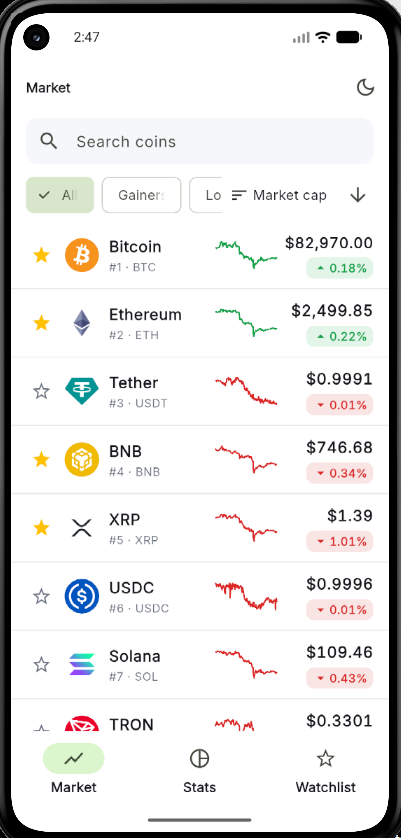 | 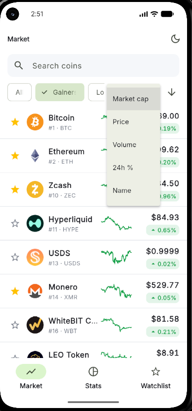 | 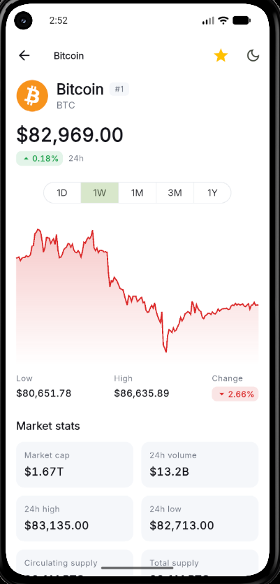 |

| Watchlist (dark) | Market Stats | Error + Retry |
|:--:|:--:|:--:|
| 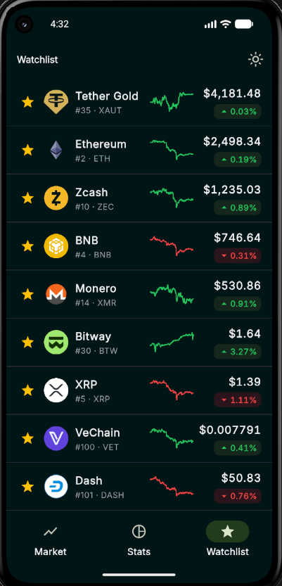 | 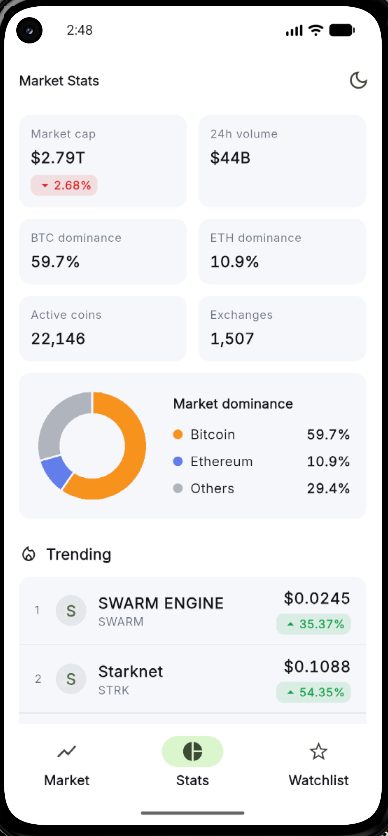 | 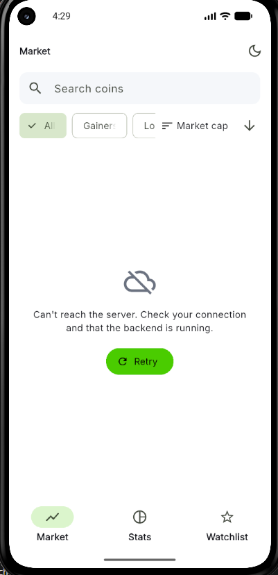 |

| Dark theme | Splash | Loading skeleton |
|:--:|:--:|:--:|
| 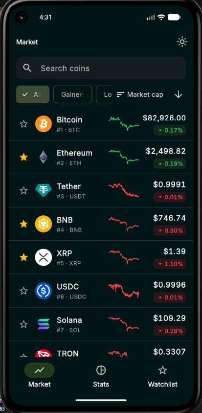 | 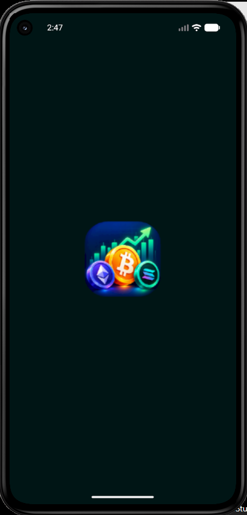 | 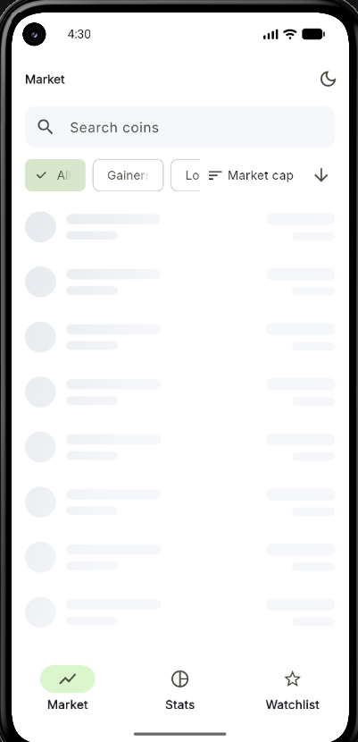 |

<details>
<summary>More screenshots</summary>

### Market and filters

| Pagination | Filter applied | Filters (dark) |
|:--:|:--:|:--:|
| 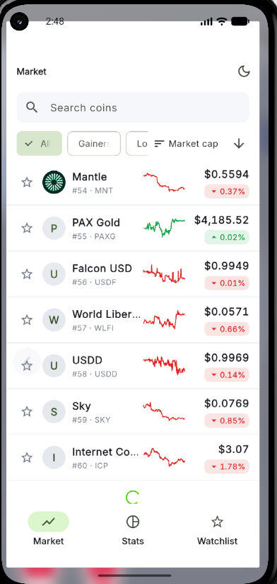 | 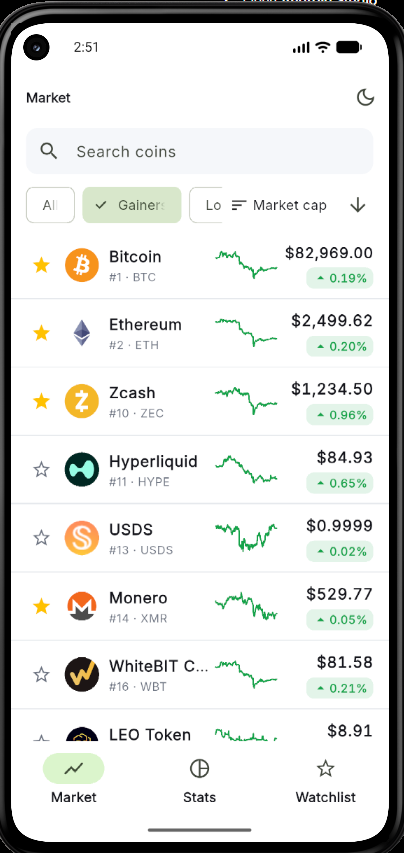 | 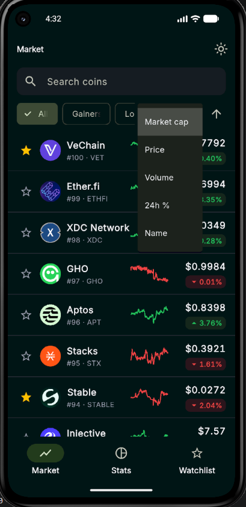 |

### Coin detail

| Detail 2 | Detail 3 | Detail 4 |
|:--:|:--:|:--:|
| 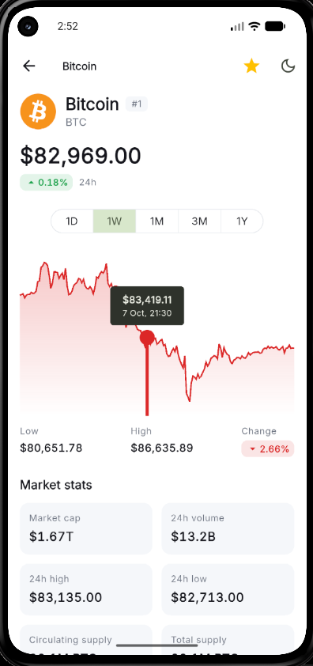 | 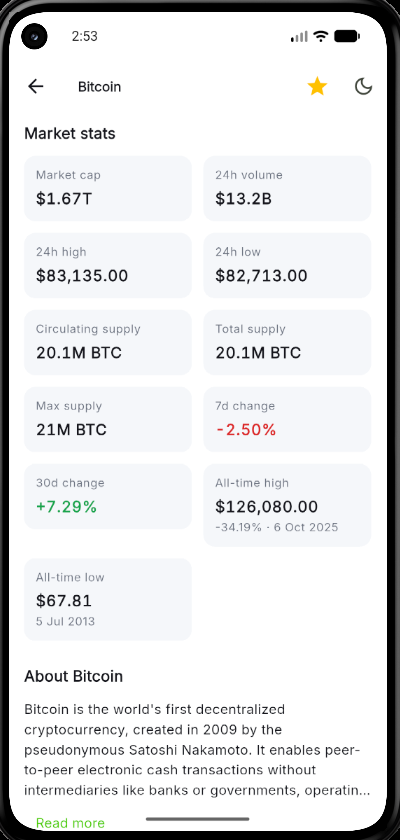 | 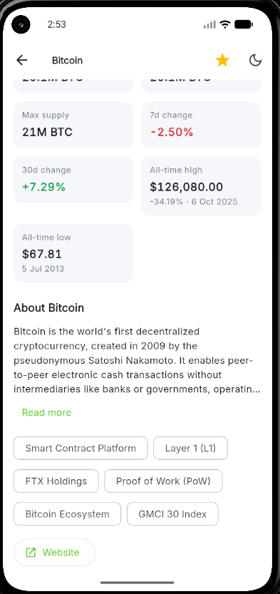 |

| Detail (dark) | Detail (dark) |
|:--:|:--:|
| 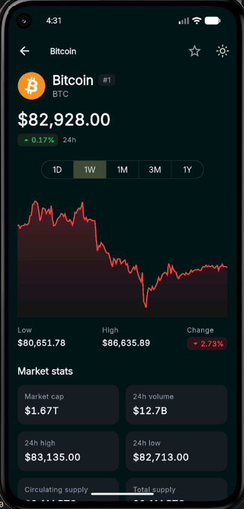 | 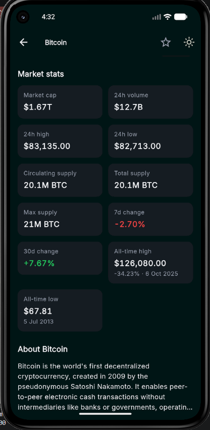 |

### Stats and watchlist

| Stats (dark) | Stats (dark) | Watchlist loading |
|:--:|:--:|:--:|
| 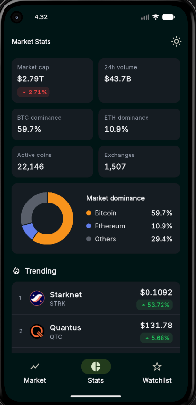 | 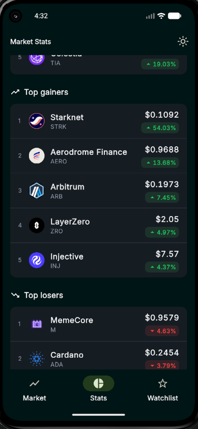 | 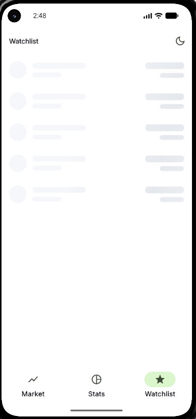 |

### Offline (fallback) banner


</details>

## Features

- **Market (coin list):** price, 24h change, market cap, 7-day sparkline, rank
- **Search** (400 ms debounce), **filter** (All / Gainers / Losers), **sort** (market cap, price, volume, 24h %, name; asc/desc)
- **Pagination** (infinite scroll), pull-to-refresh, silent auto-refresh every 60 s
- **Coin detail:** price header, interactive line chart with touch tooltip, range tabs (1D / 1W / 1M / 3M / 1Y), market stats (volume, 24h high/low, supplies, ATH/ATL, 7d/30d change), about section with website link
- **Market stats:** total market cap, 24h volume, BTC/ETH dominance (donut chart), active coins, exchanges, trending coins, top gainers, top losers
- **Watchlist:** star toggle on list and detail, persisted on device, swipe to remove with Undo
- **Loading / error / empty states:** shimmer skeletons, error view with Retry, empty views
- **Offline resilience:** if CoinGecko is unreachable the backend serves stale cache or fallback data and the app shows an "offline data" banner
- **Light and dark theme** (persisted)

## Tech stack

| Layer | Technology |
|---|---|
| Mobile app | Flutter, Dart |
| State management | `flutter_riverpod` (Notifier / AsyncNotifier / FutureProvider) |
| Architecture | MVVM (View, ViewModel, Repository, Model) |
| Networking | `dio` |
| JSON models | `json_serializable` + `build_runner` |
| Navigation | `go_router` (bottom-nav shell + detail route) |
| Charts | `fl_chart` |
| Local storage | `shared_preferences` (watchlist ids, theme) |
| Other | `google_fonts` (Inter), `cached_network_image`, `shimmer`, `intl`, `url_launcher` |
| Backend | Node.js, Express |
| Data source | CoinGecko API (Demo plan) |
| Hosting | Render (backend) |

## Architecture

```
Flutter App  ──HTTP──▶  Node.js Backend  ──▶  CoinGecko API
(View → ViewModel       (cache, fallback,
 → Repository)           response mapping)
```

### Why a backend?

- The CoinGecko API key stays on the server, never inside the app.
- A 60 s in-memory cache keeps the app inside the free-plan rate limit.
- Responses are normalized to clean camelCase JSON.
- Search, filter, sort and pagination run on the cached top-100 list (no extra API calls).
- The app keeps working when the API is down (fallback data).

### Data resolution order (backend)

```
1. Fresh cache (< 60 s)       → source: "cache"
2. CoinGecko live API         → source: "live"
3. API failed, old cache      → source: "stale"
4. API failed, no cache       → mock data → source: "fallback"
```

Every response contains a `source` field; the app shows a banner when it is `stale` or `fallback`.

### Flutter layers

| Layer | Responsibility |
|---|---|
| Model | JSON to Dart objects (`json_serializable`) |
| Repository | Dio calls, error mapping |
| ViewModel | UI state and actions (search, sort, toggle, refresh) |
| View | Widgets only, no API or JSON logic |

Provider choice: `Notifier` for complex state (list with search/sort/filter/pagination, watchlist), `FutureProvider.family` for simple loads (detail, chart per `(id, days)`), `AsyncNotifier` for stats.

## Project structure

```
.
├── backend/
│   ├── .env.example
│   └── src/
│       ├── server.js        # Express setup, CORS, error handler
│       ├── config.js        # env values, cache TTLs
│       ├── routes.js        # endpoints + query validation
│       ├── service.js       # cache → live → stale → fallback
│       ├── coingecko.js     # CoinGecko calls + response mapping
│       ├── cache.js         # in-memory TTL cache
│       └── fallback.js      # mock data
└── app/
    ├── .env.dev             # API_BASE_URL for local backend
    ├── .env.prod            # API_BASE_URL for deployed backend
    └── lib/
        ├── main.dart, app.dart
        ├── core/            # config, network, router, storage, theme, utils, shared widgets
        └── features/
            ├── market/        # data/ (models, repository) + presentation/ (view, viewmodel, widgets)
            ├── coin_detail/
            ├── stats/
            └── watchlist/
```

## API reference (backend)

Base path: `/api`

| Endpoint | Description | Query params |
|---|---|---|
| `GET /health` | Health check | - |
| `GET /coins` | Coin list | `q`, `sort` (`market_cap`, `price`, `volume`, `change_24h`, `name`), `order` (`asc`, `desc`), `filter` (`all`, `gainers`, `losers`), `page`, `perPage` (1-100) |
| `GET /coins/:id` | Coin detail | - |
| `GET /coins/:id/chart` | Price chart points `[{t, p}]` | `days` (`1`, `7`, `30`, `90`, `365`) |
| `GET /stats` | Global stats, trending, top gainers/losers | - |
| `GET /watchlist` | Prices for saved coins | `ids` (comma separated) |

Example: `GET /api/coins?q=eth&sort=price&order=desc&filter=gainers&page=1&perPage=20`

Errors: `400` invalid params, `404` unknown coin, `500` unexpected error (JSON `{ "error": "..." }`).

## Getting started

### Prerequisites

- Node.js 18+
- Flutter 3.27+ (Dart 3)
- A free [CoinGecko Demo API key](https://www.coingecko.com/en/api) (only needed to run the backend locally)
- Android emulator or device

### Quick start (deployed backend, no API key needed)

```bash
cd app
flutter pub get
dart run build_runner build --delete-conflicting-outputs
flutter run --dart-define-from-file=.env.prod
```

> The backend runs on Render's free plan. **The first request after inactivity can take up to ~1 minute** while the service wakes up. If the first load shows a timeout, open the health URL above once, then retry in the app.

### Run everything locally

#### 1. Backend

```bash
cd backend
npm install
```

Create `.env` from the example and add your key:

```bash
cp .env.example .env        # Windows: copy .env.example .env
```

```env
PORT=3000
COINGECKO_API_KEY=your_demo_key_here
```

Start the server:

```bash
npm run dev      # auto-restart on changes
# or
npm start
```

Check it:

```bash
curl http://localhost:3000/api/health
curl "http://localhost:3000/api/coins?perPage=3"
```

`"source": "live"` in the response means your API key works.

#### 2. Flutter app against the local backend

```bash
cd app
flutter pub get
dart run build_runner build --delete-conflicting-outputs
flutter run --dart-define-from-file=.env.dev
```

### Environment configuration

**Flutter** (`app/`), passed with `--dart-define-from-file`:

| File | `API_BASE_URL` |
|---|---|
| `.env.dev` | `http://10.0.2.2:3000/api` (local backend, Android emulator; `10.0.2.2` = host machine) |
| `.env.prod` | `https://crypto-market-tracker-tara.onrender.com/api` (deployed backend) |

Using a real device with the local backend? Set `API_BASE_URL` in `.env.dev` to your computer's LAN IP (for example `http://192.168.1.5:3000/api`).

**Backend** (`backend/.env` locally, or environment variables on Render):

| Variable | Purpose |
|---|---|
| `COINGECKO_API_KEY` | CoinGecko Demo API key (server only) |
| `PORT` | Server port (Render sets it automatically) |

The Flutter env files contain only the backend URL (not a secret). The CoinGecko API key is never stored in the app, and `backend/.env` is git-ignored.

### Release build

```bash
cd app
flutter build apk --dart-define-from-file=.env.prod
```

## Manual test checklist

1. Market: list loads, search `eth`, Gainers/Losers chips, change sort and order, scroll for next page
2. Tap a coin: chart touch tooltip, switch 1D / 1W / 1M / 3M / 1Y
3. Star coins, open Watchlist, swipe to remove and Undo, restart the app (list persists)
4. Stats tab: cards, dominance chart, trending, gainers, losers
5. Toggle dark/light theme
6. Stop the local backend, pull to refresh: error view with Retry
7. Use a wrong API key on the backend: app shows the offline-data banner with fallback data

## Known limitations and next steps

- Top gainers/losers are computed from the cached top-100 coins (CoinGecko's gainers/losers endpoint is a paid feature), so they differ from the website.
- "Live" prices are polled every 60 s. CoinGecko WebSocket streaming needs a paid plan.
- Fallback data covers 8 coins (BTC and ETH use real sample values, charts are generated).
- Watchlist is stored on the device only (no accounts).
- Automated tests are not included yet. Planned: formatter unit tests, ViewModel tests with a fake repository (Riverpod provider overrides), widget tests.
- Not yet tested on iOS.

## Author

Built by Vignesh as a Flutter developer assignment.